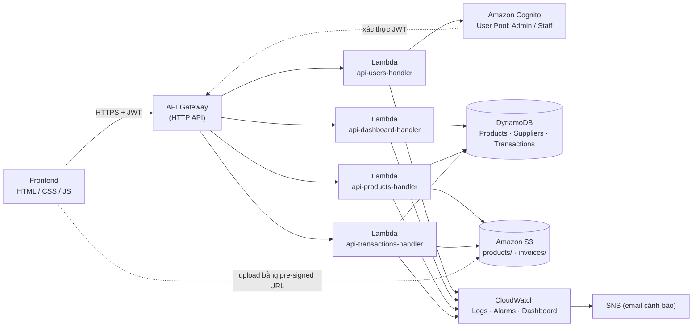

# CloudStock – Hạ tầng Cloud (Serverless trên AWS)

Đồ án cuối kỳ môn **Điện toán đám mây** – Nhóm 4.
Hệ thống quản lý kho & hàng hóa xây dựng theo kiến trúc **Serverless** với **AWS Lambda, Amazon S3, Amazon DynamoDB**.
Toàn bộ hạ tầng được khai báo bằng **Infrastructure as Code (AWS SAM / CloudFormation)** nên dựng lại được bằng một lệnh.

## Kiến trúc



| Dịch vụ | Vai trò |
|---|---|
| **API Gateway (HTTP API)** | Cổng vào duy nhất, xác thực JWT của Cognito, bật CORS, giới hạn tốc độ (20 req/s) |
| **Cognito** | Đăng nhập, 2 nhóm quyền `Admin` / `Staff` (không cho tự đăng ký) |
| **Lambda (Python 3.12)** | 4 hàm nghiệp vụ + 1 Layer dùng chung, mỗi hàm một IAM role riêng (least privilege) |
| **DynamoDB (On-Demand)** | `Products`, `Suppliers`, `Transactions` (+ GSI `productId-createdAt-index`, bật PITR) |
| **S3** | `products/` ảnh công khai (chỉ đọc), `invoices/` hóa đơn riêng tư; mã hóa SSE, versioning, CORS |
| **CloudWatch + SNS** | Log (lưu 14 ngày), 5 alarm (lỗi Lambda, API 5xx), dashboard, email cảnh báo |

## Cấu trúc thư mục

```
template.yaml            # Toàn bộ hạ tầng (SAM)
samconfig.toml           # Cấu hình deploy (stack, region)
layers/common/python/    # Lambda Layer: build_response, JWT user, clients boto3...
src/api_*_handler/app.py # 4 hàm Lambda đầy đủ nghiệp vụ (+ endpoint /_ping kiểm tra kết nối)
tests/                   # 67 test tự động (moto giả lập AWS), chạy: pytest tests
API.md                   # Đặc tả chi tiết các endpoint
seed/*.json              # Dữ liệu mẫu cho 3 bảng
scripts/                 # seed.py, create_admin.py, get_token.py, print_config.py
```

## Yêu cầu

- Tài khoản AWS + [AWS CLI](https://aws.amazon.com/cli/) đã `aws configure` (region `ap-southeast-1`)
- [AWS SAM CLI](https://docs.aws.amazon.com/serverless-application-model/latest/developerguide/install-sam-cli.html)
- Python 3.9+ và `pip install -r scripts/requirements.txt`

## Triển khai (lần đầu ~10 phút)

```bash
# 1. Dựng toàn bộ hạ tầng
sam deploy

# 2. Nạp dữ liệu mẫu vào DynamoDB
python scripts/seed.py

# 3. Tạo tài khoản Admin (mật khẩu nhập tại dòng lệnh, không lưu vào repo)
python scripts/create_admin.py --email email-cua-ban@gmail.com

# 4. Sinh file config.js cho frontend (có API URL, Cognito ID thật)
python scripts/print_config.py
```

Tham số tùy chọn của `sam deploy`:

| Tham số | Mặc định | Khi nào dùng |
|---|---|---|
| `BucketName` | `qlkho-assets-nhom4-2026` | Đổi nếu tên bucket đã bị chiếm |
| `ResourceSuffix` | *(trống)* | Thêm hậu tố (vd `-iac`) khi bảng/hàm/user pool tạo tay trước đó đã trùng tên |
| `AlertEmail` | *(trống)* | Email nhận cảnh báo CloudWatch |

```bash
sam deploy --parameter-overrides BucketName=qlkho-assets-nhom4-v2 ResourceSuffix=-iac AlertEmail=ban@gmail.com
```

> Nếu máy không có SAM CLI, dùng AWS CLI:
> `aws cloudformation package --template-file template.yaml --s3-bucket <bucket-tạm> --output-template-file packaged.yaml`
> rồi `aws cloudformation deploy --template-file packaged.yaml --stack-name qlkho-nhom4 --capabilities CAPABILITY_IAM --region ap-southeast-1`

## Kiểm tra sau khi deploy

1. Lấy token: `python scripts/get_token.py --email email-cua-ban@gmail.com`
2. Gọi thử (Postman hoặc `curl.exe` trên Windows):
   ```
   GET  <ApiBaseUrl>/products/_ping       Header: Authorization: Bearer <token>
   ```
   Kết quả `{"ok": true, ...}` nghĩa là chuỗi **API Gateway → JWT → Lambda → IAM → DynamoDB/S3** đã thông.
   Các endpoint `/users/_ping`, `/dashboard/_ping`, `/transactions/_ping` kiểm tra tương tự.
3. Không có token → API trả `401 Unauthorized` (đúng thiết kế).
4. Xem **CloudWatch Dashboard** theo link ở Outputs (`DashboardUrl`).

## Bàn giao cho nhóm

**Frontend:** chạy `python scripts/print_config.py`, dán kết quả vào `frontend/js/config.js`.

**Backend:** code 4 hàm Lambda đã viết đầy đủ theo đặc tả API của nhóm (xem `API.md`). Mỗi hàm nằm ở `src/api_*_handler/app.py`, dùng chung `from common import *`. Sửa xong chạy `pytest tests` rồi `sam build && sam deploy`.
Cập nhật nhanh 1 hàm khi đang phát triển:
```bash
aws lambda update-function-code --function-name api-products-handler --zip-file fileb://function.zip
```

| Lambda | Route API Gateway | Quyền IAM chính |
|---|---|---|
| api-users-handler | `/users`, `/users/{proxy+}` | Cognito (quản lý user trong pool) |
| api-dashboard-handler | `GET /dashboard` | DynamoDB đọc 3 bảng |
| api-products-handler | `/products*`, `/suppliers*` | DynamoDB CRUD Products/Suppliers, S3 `products/*` `invoices/*` |
| api-transactions-handler | `/transactions*` | DynamoDB Transactions + cập nhật Products, S3 đọc `invoices/*`, CloudWatch Logs |

Các điểm kỹ thuật đã xử lý trong code:
- JWT Authorizer chỉ **xác thực**; phân quyền Admin/Staff được kiểm tra trong code (`require_role`).
- **Chống âm kho:** nhập/xuất kho cập nhật tồn + ghi phiếu trong một `transact_write_items`, có điều kiện "tồn kho chưa bị ai đổi từ lúc đọc"; nếu có người khác thao tác cùng lúc thì đọc lại và thử lại.
- Presigned URL: `ContentType` lúc tạo phải khớp lúc frontend PUT; `s3_client` trong `common.py` đã cấu hình s3v4 đúng region.
- Truy vấn giao dịch theo sản phẩm dùng GSI `productId-createdAt-index` (không phải quét cả bảng).
- Admin không thể tự xóa / tự khóa / tự hạ quyền chính mình.

## Kiểm thử

```bash
pip install -r requirements-dev.txt
pytest tests
```
Các test chạy trên AWS giả lập (moto), không cần tài khoản AWS và không tốn phí; gồm cả tình huống 2 người xuất kho cùng lúc.

## Bảo mật

- Không commit mật khẩu, access key hay file `.env` (đã có trong `.gitignore`). Tài khoản admin tạo bằng `scripts/create_admin.py`.
- Mỗi Lambda có IAM role riêng, chỉ cấp đúng quyền cần thiết trên đúng tài nguyên.
- S3: Block Public ACL, mã hóa mặc định, chỉ `products/*` được đọc công khai; hóa đơn truy cập qua pre-signed URL có thời hạn.
- Cognito chặn tự đăng ký, chính sách mật khẩu tối thiểu 8 ký tự gồm hoa/thường/số.

## Chi phí

Toàn bộ dịch vụ tính theo mức dùng (pay-per-use), phần lớn nằm trong AWS Free Tier. Nên đặt **AWS Budgets** cảnh báo ở mức 1–5 USD.

## Dọn dẹp tài nguyên (sau khi chấm điểm)

```bash
aws s3 rm s3://qlkho-assets-nhom4-2026 --recursive   # bucket phải rỗng (có versioning: dùng Console → Empty)
sam delete
```
